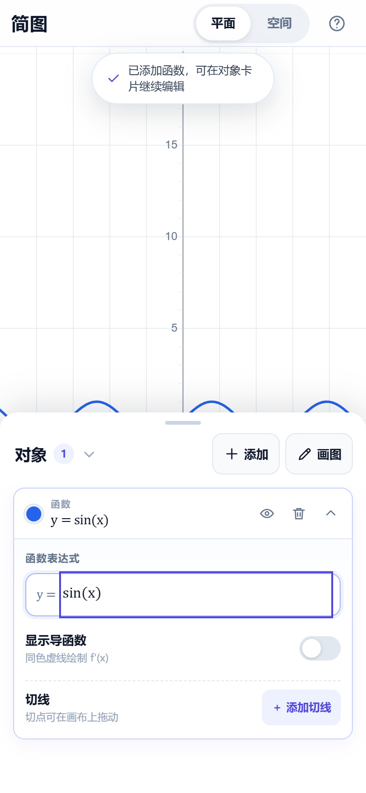
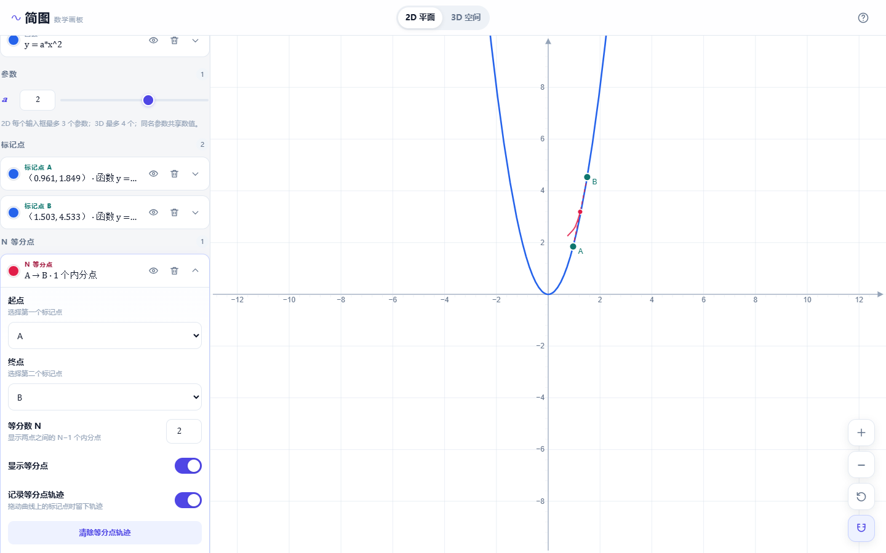
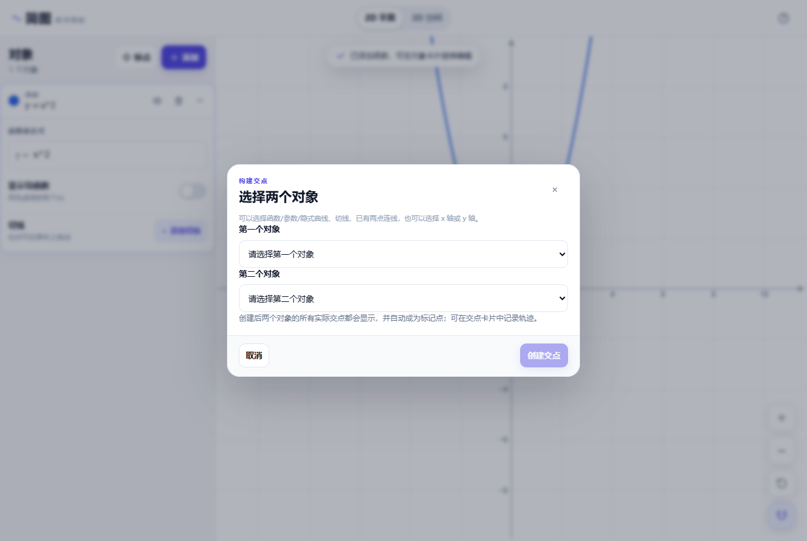
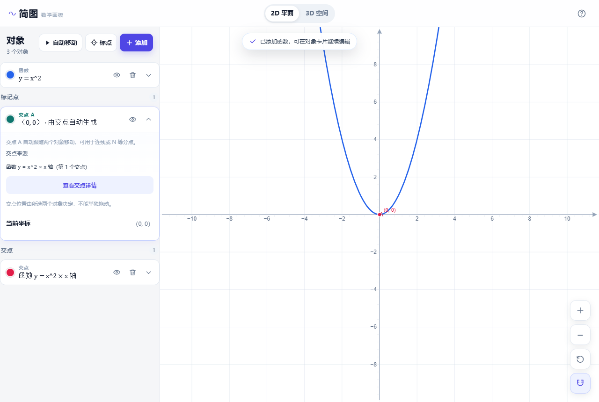
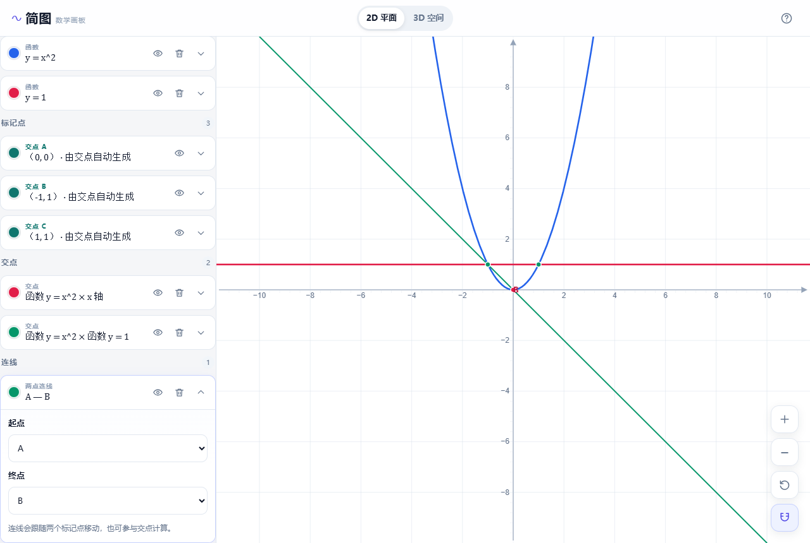
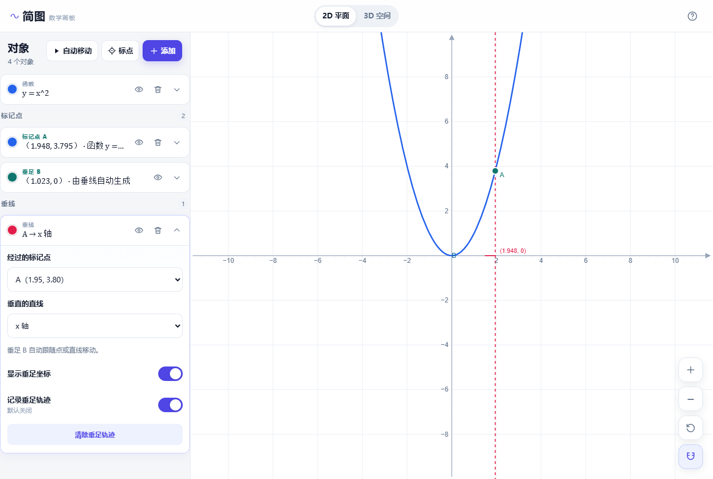
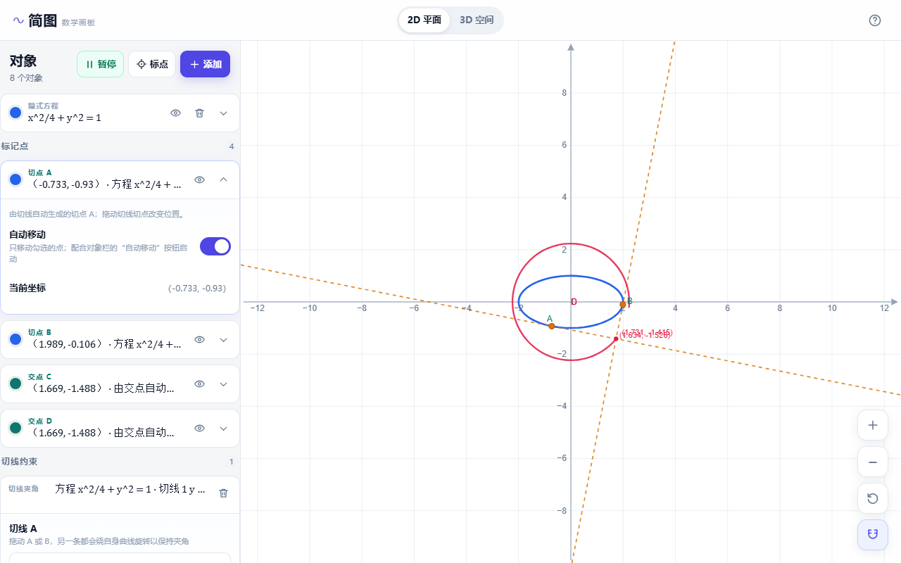
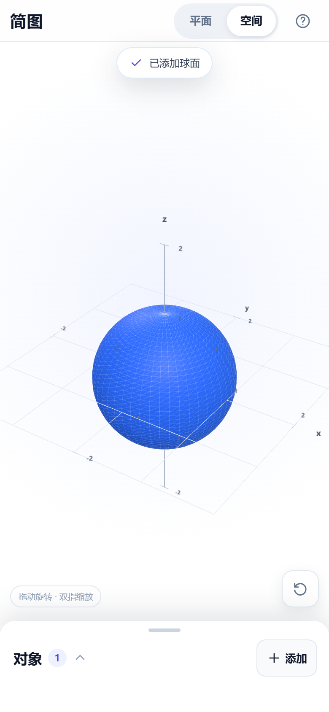

# 简图 · 数学画板

面向高中生和非数学专业大学生的本地数学作图 Web 应用。输入表达式即可在 2D/3D 坐标系中绘图；2D 支持在表达式曲线上作多条切线、切线夹角约束、任意两个对象的交点、两切线交点轨迹、标记点连线，以及过标记点作垂线，3D 支持隐式方程。

**在线使用：** <https://math-plot-tool.pages.dev/>（Cloudflare Pages）

- **手机优先**：全屏画布 + 可收起底部面板 + 大触控目标
- **离线运行**：安装依赖后不访问 CDN、外部字体或接口
- **绝不崩溃**：表达式、单条曲线、JSXGraph 元素和 3D 场景都有错误隔离
- 2D 渲染：[JSXGraph](https://jsxgraph.org/)
- 表达式解析/求导/化简：[mathjs](https://mathjs.org/)
- 公式排版：[KaTeX](https://katex.org/)
- 3D：[Three.js](https://threejs.org/)

完整验收记录见 [ACCEPTANCE.md](ACCEPTANCE.md)。










## 快速开始

### 环境

- Node.js 20+（建议 22/24）
- Chrome / Edge 最新版
- 手机端：iOS Safari 16+ / Android Chrome 最新版

### 启动

```bash
npm install
npm run dev
```

浏览器打开 <http://127.0.0.1:5173/>。

Windows 也可以双击 `启动.bat`（首次运行会自动安装依赖并打开浏览器）。

### 手机访问

手机和电脑连同一个 Wi-Fi：

1. 在电脑上执行 `npm run dev`（项目脚本已默认监听 `0.0.0.0`）；
2. 终端会打印 Network 地址，例如 `http://192.168.1.23:5173/`；
3. 手机浏览器打开这个地址；
4. 如果访问不了，请允许 Windows 防火墙对 Node.js 的局域网访问。

### 生产构建

```bash
npm run build
npm run preview
```

构建产物在 `dist/`，可由任意静态文件服务器托管。

## 功能

### 标记点、自动移动与 N 等分点

- 点对象栏的“标点”，再点击曲线附近；系统会吸附到最近的曲线并弹出确认卡片
- 确认后自动命名为 A、B、C…，也可以取消
- 标记点可以在所属曲线上直接拖动
- 滚轮缩放或平移坐标轴时，标记点保持原世界坐标不变，不会沿曲线漂移
- 每条切线的切点会自动注册为标记点（显示为“切点 A/B/…”）
- 只有勾选了“自动移动”的标记点会移动；对象栏按钮负责启动/暂停
- 点击曲线外位置可创建自由点，自由点可手动输入固定横纵坐标
- 曲线上的手动标记点可固定 x 或 y 坐标，另一个坐标由曲线自动求出
- “添加 → N 等分点”选择两个标记点，按两点连线显示 N−1 个内分点
- 可记录这些内分点的轨迹；拖动标记点或自动移动时轨迹实时更新

### 通用交点与两点连线

- “添加 → 交点”会先弹出选择框，手动选择两个对象后再创建；之后也可以在该交点卡片中重新选择
- 可选对象：曲线、切线、已有连线或 x/y 坐标轴
- 两个对象的所有实际交点都会显示，并自动注册为标记点（显示为“交点 A/B/…”）
- 支持隐式方程之间的交点：数值网格定位零点轮廓，再用二维牛顿迭代精修
- 交点坐标默认隐藏，可在交点卡片中手动打开“显示交点坐标”
- 多个交点落在同一位置时，默认只保留最先出现的点，不重复生成标记点
- 交点标记点可直接用于“两点连线”、N 等分点和后续交点计算
- 交点标记点卡片中会显示来源对象；点“查看交点详情”可打开所选两个对象
- 普通交点不记录轨迹，避免无意义轨迹和卡顿；轨迹只保留在两切线交点卡片中
- 交点元素只在坐标、显隐或颜色变化时更新，自动移动和快速拖动时不会重复刷新隐藏元素
- 切线交点与普通曲线交点共用同一个“交点”入口；切线夹角约束自动生成的交点也会自动成为标记点
- “添加 → 两点连线”会先弹出选择框，手动选择两个标记点后再创建直线
- 连线会随两个标记点移动，也可以作为“交点”的一个对象，与曲线或坐标轴求交点
- 即使连线端点是交点自动标记点，拖动源点时连线也会实时跟随，不会等到松手后才更新
- 可显示/隐藏等分点和轨迹、修改 N、更换端点、改变颜色

### 垂线与垂足

- “添加 → 过点作垂线”会先弹出选择框，手动选择**经过的标记点**和**垂直的直线**
- 可选直线包括 x/y 坐标轴、两点连线、切线，以及能识别为直线的函数或隐式方程
- 垂线用虚线绘制，垂足自动注册为标记点（显示为“垂足 A/B/…”）
- 垂足可参与两点连线、N 等分点和交点计算
- 垂足坐标默认隐藏，可在垂线卡片中打开“显示垂足坐标”
- 垂足轨迹默认关闭，可在垂线卡片中打开“记录垂足轨迹”
- 移动源标记点或目标直线时，垂线、垂足和已开启的轨迹实时更新
- 垂足标记点卡片会显示“过点 X 作某直线的垂线”，并可跳转到垂线详情

### 切线、切点与交点

- 每条表达式曲线可添加**多条切线**，切点独立拖动
- 每条切线的切点自动成为标记点，可用于 N 等分点和自动移动
- 添加切线夹角约束后，会自动创建两条切线的交点并开启轨迹记录
- 交点卡片中可直接查看轨迹方程和推导过程（支持标准圆锥曲线；90° 特例和圆的任意固定角）
- 目标切点使用解析/分支连续求解，快速拖动时交点轨迹不会在两条平行切线间跳变
- 可显示交点坐标，并在移动切线时记录交点轨迹
- 两条垂直切线的交点轨迹可演示椭圆的蒙日圆

### 切线夹角约束

- “添加 → 切线夹角约束”选择两条切线，设置固定夹角（90° 即垂直）
- 拖动任一条切线时，另一条切线会沿自身曲线自动旋转到目标角度
- 目标切点沿当前曲线分支连续寻找，不会跳到另一条平行的切线
- 隐式曲线切线使用解析梯度计算，实际夹角与设置值一致
- 目标切点由曲线上的数值搜索确定；支持函数、参数曲线和隐式曲线
- 可交换两条切线的角色

### 参数

- 表达式中未被保留的单字母自动识别为参数
- 数字输入 + 滑条，拖动滑条实时更新
- **2D 每个输入框最多 3 个参数；3D 最多 4 个**
- 同名参数共享数值
- `e` 是自然常数，不能作为参数；参数建议使用 `a、b、c、k、m` 等

### 2D 表达式

- 显式函数 `y = f(x)`
- 参数曲线 `(x(t), y(t))`
- 隐式方程 `F(x, y) = 0`（也可写带等号的形式）
- 导函数：开关后显示公式和同色虚线
- 多曲线独立颜色、显隐、删除

### 3D

- 显式曲面 `z = f(x, y)`
- 参数曲面 `(x(u,v), y(u,v), z(u,v))`
- 空间曲线 `(x(t), y(t), z(t))`
- 隐式曲面 `F(x, y, z) = 0`（例如 `A*x + B*y + C*z + D = 0`）
- 3D 每个输入框最多 4 个参数，2D 仍为 3 个
- 鼠标/手指轨道旋转、滚轮/双指缩放、重置视角
- 独立颜色、显隐、删除、范围与精度设置
- 3D 保持基础能力，不做 3D 切线等进阶功能

## 输入语法

| 输入 | 含义 |
|---|---|
| `x^2` | 幂 |
| `sin(x)`、`cos(x)`、`tan(x)` | 三角函数（弧度） |
| `asin(x)` / `arcsin(x)` | 反三角函数 |
| `ln(x)` | 自然对数 |
| `lg(x)` | 以 10 为底的对数 |
| `sqrt(x)`、`abs(x)`、`exp(x)` | 常用函数 |
| `pi`、`π` | 圆周率 |
| `e` | 自然常数 |
| `2x`、`2(x+1)` | 隐式乘法 |
| `x*y` | 两个字母相乘请写乘号 |
| `x^2 + y^2 = 4` | 隐式方程 |

也支持 `y = ...`、`z = ...`、`x(t) = ...` 等常见左侧写法。全角括号、`×`、`÷`、`−`、`π`、`²` 等会自动规范化。

函数名后必须加括号，例如写 `sin(x)` 而不是 `sinx`。

## 交互

### 手机

- 画布：单指拖动平移、双指捏合缩放
- 底部面板：点“对象”或拖动把手展开/收起；编辑时输入框会自动滚入可视区
- 软键盘弹出时面板会自动上移；iOS 使用 `visualViewport`，Android 使用 `interactive-widget=resizes-content`
- “添加”打开对象菜单
- 横屏时展开的面板会变成右侧面板，保留左侧图像区

### 桌面

- 左侧对象栏，右侧画布
- 鼠标滚轮以指针位置为中心缩放；左键拖空白平移
- 右下角缩放/复位/吸附
- 表达式卡片内添加切线与设置切线约束

## 数据与隐私

- 画板自动保存到浏览器 `localStorage`
- 不包含账号、云同步或任何外部接口
- 运行时不发起外部网络请求（KaTeX 字体随构建本地提供）
- “帮助 → 清空画板”可清除当前画板

## 开发与测试

```bash
npm run typecheck    # TypeScript 检查
npm test             # Vitest 单元测试
npm run build        # 生产构建
npm run test:e2e     # Playwright + 本机 Chrome 端到端测试
```

`npm run test:e2e` 默认访问 <http://127.0.0.1:5173/>；请先启动 `npm run dev`，或用 `APP_URL=http://127.0.0.1:4173/` 指向 preview 服务。E2E 使用的是本机已安装的 Chrome（`playwright-core`），不会下载额外浏览器。

测试覆盖：

- 表达式规范化、优先级、错误提示、2D 参数上限
- 3D 隐式方程、3D 四参数上限与 z 变量
- 标记点命名、N 等分比例与插值
- 切线交点轨迹方程（椭圆蒙日圆、圆、双曲线、抛物线）
- 符号求导与数值对照
- 切线角度数值求解（显式、隐式曲线）
- 隐式曲面 marching tetrahedra 网格提取
- 桌面/手机/横屏 UI、导函数、多切线、切线夹角、通用交点（含隐式×隐式）、标记点连线、垂线与垂足、标记点、自动移动、N 等分点轨迹、持久化、3D
- 手机触摸：双指缩放、3D 单指旋转（CDP 触摸模拟）
- 外部网络拦截、控制台错误收集、损坏 localStorage 恢复

测试截图在 `artifacts/e2e/`。

## 目录结构

```
src/
  app/             store、类型、持久化、工具
  core/
    expression/    mathjs 封装、规范化、参数/错误
    plot2d/        2D 分析、JSXGraph 适配、切线角度求解
    plot3d/        Three.js 场景、隐式曲面网格
  components/      页面、卡片、底部面板、对话框
  styles/          全局样式
tests/
  unit/            单元测试
  e2e/             端到端测试
```

## 已知边界

- 2D 每个输入框最多 3 个参数，3D 最多 4 个；参数名只支持单个字母
- 手绘几何功能已移除；圆、椭圆、抛物线、双曲线请用隐式方程表示
- 标记点通过点击位置吸附到最近曲线，吸附容差约为 28 像素
- 垂线支持坐标轴、两点连线、切线，以及可识别为直线的函数/隐式方程
- 过点作垂线时垂足坐标与轨迹默认关闭，需在垂线卡片中手动开启
- N 等分点按两点连线插值，不按曲线弧长等分
- 切线夹角约束只作用于表达式曲线生成的切线；约束通过移动目标切点实现
- 切线交点为两条切线的实际交点；平行切线时隐藏
- 通用交点最多同时显示 8 个，每个交点自动生成一个标记点
- 只有两条切线的交点保留轨迹功能；其他对象的交点不记录轨迹
- 3D 隐式曲面使用数值网格提取，范围与精度需要手动设置
- 3D 为基础曲面/曲线浏览，不含 3D 切线
- 不做不等式区域、积分、极坐标、向量场、图片导出、云同步、撤销重做
- 手机端优先竖屏；横屏、平板可用但布局会折叠

## 许可证

本项目采用 [MIT License](LICENSE)。

第三方依赖及其许可证见 [THIRD_PARTY_NOTICES.md](THIRD_PARTY_NOTICES.md)。

---

如果发现表达式、切线、轨迹方程或移动端交互的问题，欢迎直接指出具体输入和现象，方便定位。
